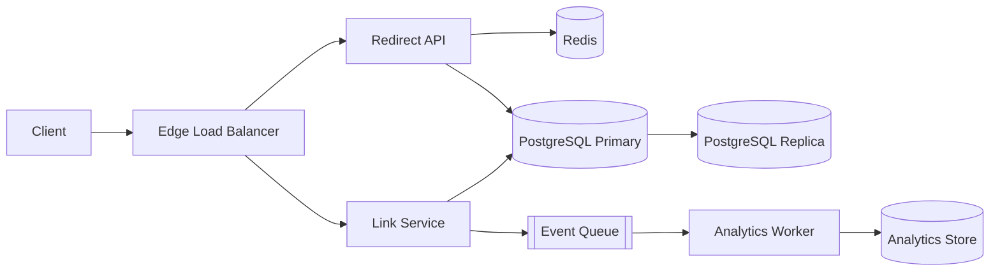

# Design Template

Copy this structure into `SYSTEM-DESIGN.md`. Replace every example value with the approved design. Preserve every HTML marker exactly. The prose may be translated; marker IDs, requirement IDs, severity values, and status values stay in English.

The template below is a complete, valid example. Keep the section order and the marker contract. Delete example content that does not apply, but do not delete a required section.

```markdown
<!-- system-design:artifact type=design version=1 -->
# System Design: URL Shortener

- Status: Draft
- Date: 2026-01-01
- Owner: Architecture team
- Artifact language: English
- Design scope: URL shortener for 10 million monthly active users
- Scale target: 25,000 peak redirect QPS and 2,500 peak create QPS

<!-- system-design:counts fr=3 nfr=4 slo=3 adr=3 risk=4 -->

<!-- system-design:section id=context -->
## 1. Context

Describe the problem, the users, the current alternative, and the business driver. State what is in scope and what is explicitly out of scope. Summarize the constraints inherited from the repository, the platform, the team, and the budget.

This design covers link creation, redirect, and asynchronous click analytics for 10 million monthly active users. Multi-tenant administration and custom domains are out of scope for this phase.

<!-- system-design:section id=requirements -->
## 2. Functional Requirements

- **FR-001**: An authenticated user must be able to create a short code for a long URL and receive the canonical short URL.
- **FR-002**: A visitor must be redirected from a valid short code to the original URL with an HTTP redirect.
- **FR-003**: The system must record a click event for analytics without blocking the redirect.

<!-- system-design:section id=nfr -->
## 3. Non-Functional Requirements

| ID | Requirement | Target | Measurement |
| --- | --- | --- | --- |
| NFR-001 | Redirect latency | p99 <= 50 ms at peak | Load test and production latency histogram |
| NFR-002 | Redirect availability | 99.95% monthly | Synthetic probes and SLO dashboard |
| NFR-003 | Link durability | 0 acknowledged link losses | Database replication lag and restore drill |
| NFR-004 | Analytics freshness | 99% of clicks visible within 5 minutes | Event pipeline lag metric |

<!-- system-design:section id=slo -->
## 4. Service Level Objectives

| ID | SLI | Target | Window | Error budget |
| --- | --- | --- | --- | --- |
| SLO-001 | Successful redirects / valid redirect requests | >= 99.95% | 30 days | 21.6 minutes |
| SLO-002 | Redirect requests faster than 50 ms | >= 99% | 30 days | 1% of requests |
| SLO-003 | Successful link creations / valid create requests | >= 99.9% | 30 days | 43.2 minutes |

<!-- system-design:section id=capacity -->
## 5. Capacity Planning

| ID | Metric | Inputs | Formula | Result | Assumption |
| --- | --- | --- | --- | --- | --- |
| CAP-001 | Peak redirect QPS | 10M MAU, 30 redirects per user per day, peak factor 5 | 10,000,000 * 30 * 5 / 86,400 | 17,361 QPS | Traffic is spread outside the peak |
| CAP-002 | Peak create QPS | 10M MAU, 3 creates per user per day, peak factor 5 | 10,000,000 * 3 * 5 / 86,400 | 1,736 QPS | Creates follow the same peak factor |
| CAP-003 | Link storage per year | 30M links/year, 500 bytes per record, 3 replicas | 30,000,000 * 500 * 3 / 1,000,000,000 | 45 GB per year | Average record size includes indexes |
| CAP-004 | Cache working set | 30M links, 500 bytes, 20% hot set | 30,000,000 * 500 * 0.20 / 1,000,000,000 | 3 GB | The hot set fits in memory with headroom |
| CAP-005 | API nodes | 17,361 QPS, 2,000 QPS per node, N+1 headroom | 17,361 / 2,000 * 2 | 18 nodes | Each node handles 2,000 QPS at p99 target |
| CAP-006 | Egress bandwidth | 17,361 QPS, 2 KB response average | 17,361 * 2,000 * 8 / 1,000,000,000 | 278 Mbps | Redirect responses dominate egress |

The dominant cost driver is compute for the redirect path, followed by managed PostgreSQL storage and Redis memory. The estimate is an order of magnitude, not a quote.

<!-- system-design:section id=architecture -->
## 6. High-Level Architecture



- The edge terminates TLS, applies rate limits, and routes create and redirect traffic separately.
- The redirect path is read-optimized and must not depend on the analytics pipeline.
- The write path validates the URL, enforces idempotency, and writes to the primary database.
- Trust boundaries: client to edge, edge to API, API to data stores, and API to the event queue.

<!-- system-design:section id=data -->
## 7. Data Model and Storage

- Main entities: `User`, `Link`, `ClickEvent`, and `ApiKey`.
- `Link` owns the unique short code and the canonical URL. `short_code` is the partition key and has a unique index.
- `ClickEvent` is append-only and stores `link_id`, timestamp, referrer, user agent hash, and coarse geography. Raw IP addresses are not stored.
- Source of truth: PostgreSQL for users, links, and API keys. The analytics store is derived and can be rebuilt from events.
- Storage choice: PostgreSQL (SQL) is chosen because link creation needs transactions, uniqueness constraints, and relational integrity. A NoSQL wide-column store was evaluated for the redirect path but rejected because the working set fits in Redis and the write volume does not justify losing transactional guarantees.
- Indexing: unique index on `short_code`, composite index on `user_id, created_at`, and a partial index for active links.
- Partitioning: hash partitioning by `short_code` if a single primary exceeds capacity; no cross-partition transactions are required.
- Replication: one synchronous standby for durability and one asynchronous read replica for analytics and exports.
- Retention: links are retained while active. Click events are retained for 13 months and then aggregated.
- Schema evolution: expand-and-contract migrations with backward-compatible reads.

<!-- system-design:section id=components -->
## 8. Components

| ID | Component | Responsibility | Interface | Owner |
| --- | --- | --- | --- | --- |
| COMP-001 | Edge Load Balancer | TLS termination, routing, and rate limiting | HTTPS | Platform |
| COMP-002 | Redirect API | Resolve short codes and issue redirects | HTTPS GET /{code} | Link team |
| COMP-003 | Link Service | Create, validate, and list links | HTTPS POST /links | Link team |
| COMP-004 | PostgreSQL | Durable source of truth for links and users | SQL | Data platform |
| COMP-005 | Redis | Cache-aside for hot links and rate-limit counters | Redis protocol | Platform |
| COMP-006 | Event Queue | Durable click events for analytics | Publish and consume | Data platform |
| COMP-007 | Analytics Worker | Aggregate clicks into the analytics store | Queue consumer | Analytics team |

<!-- system-design:section id=flows -->
## 9. Flows

| ID | Flow | Trigger | Steps | Failure behavior |
| --- | --- | --- | --- | --- |
| FLOW-001 | Create link | User submits a URL | Validate, check quota, allocate code, insert, return short URL | Return a typed error and do not partially write |
| FLOW-002 | Redirect | Visitor requests a short code | Check cache, fall back to replica, redirect, publish click event | Serve from cache or replica; if both fail, return 503 |
| FLOW-003 | Click analytics | Redirect succeeds | Publish event, consume in batch, write to analytics store | Buffer in the queue and retry with backoff |
| FLOW-004 | Database failover | Primary becomes unavailable | Promote standby, update endpoint, drain and retry | Redirect serves cached links; creates fail until promotion completes |

<!-- system-design:section id=tradeoffs -->
## 10. Trade-offs

| Decision | Chosen | Alternative | Trade-off |
| --- | --- | --- | --- |
| Redirect consistency | Cache-aside with a short TTL | Strong read from primary | Lower latency and database load, at the cost of brief staleness after edits |
| Analytics delivery | Asynchronous queue | Synchronous write per click | Redirect stays fast, at the cost of eventual analytics freshness |
| Architecture style | Modular monolith with separate redirect workers | Full microservices | Lower operational burden now, at the cost of future extraction work |
| Data store | PostgreSQL plus Redis | Single wide-column store | Transactional integrity and simpler operations, at the cost of two systems to run |

<!-- system-design:section id=risks -->
## 11. Risks

| ID | Risk | Likelihood | Impact | Severity | Confidence | Mitigation | Owner |
| --- | --- | --- | --- | --- | --- | --- | --- |
| RISK-001 | Hot link causes cache stampede | Medium | High | High | Likely | Request coalescing, jittered TTL, and per-key limits | Link team |
| RISK-002 | Primary database is a single point of failure | Low | High | High | Confirmed | Synchronous standby, tested failover, and connection retry | Data platform |
| RISK-003 | Queue backlog delays analytics | Medium | Medium | Medium | Likely | Partitioned consumers, lag alerts, and backpressure | Analytics team |
| RISK-004 | Egress cost grows faster than traffic | Medium | Medium | Medium | Assumption | Per-tenant quotas, cost alerts, and response compression | Platform |

<!-- system-design:section id=security -->
## 12. Security

### Threat model

| ID | Threat | Asset | Actor | Boundary | Control |
| --- | --- | --- | --- | --- | --- |
| THREAT-001 | Short-code enumeration and scraping | Link inventory | External attacker | Client to edge | Rate limit by IP and API key, anomaly detection, and random codes |
| THREAT-002 | Malicious or phishing destination | User trust and brand | External attacker | Create API | URL reputation checks, blocklists, and abuse review |
| THREAT-003 | Credential stuffing on the admin path | User accounts | External attacker | Admin to API | MFA, lockout, breached-password checks, and audit logs |
| THREAT-004 | Cross-tenant data exposure | Tenant links and analytics | Authenticated user | API to database | Row-level authorization, tenant-scoped queries, and tests |

- Authentication: OIDC with short-lived tokens for users and scoped API keys for integrations.
- Authorization: role-based access with tenant scoping enforced in the data access layer.
- Input validation: allowlist URL schemes, limit length, and reject private network targets.
- Secrets: injected at runtime from the platform secret manager, rotated on a schedule, and never logged.
- Rate limiting: per IP, per API key, and per tenant, with a documented burst allowance.
- Encryption: TLS in transit and encryption at rest for databases, backups, and queues.
- Logging: audit events for create, delete, and permission changes; no raw IP, token, or URL query secrets.

<!-- system-design:section id=observability -->
## 13. Observability

- Logs: structured JSON with request ID, tenant ID, route, status, and latency; no secrets or personal data.
- Metrics: redirect QPS, create QPS, error rate, p50/p95/p99 latency, cache hit ratio, database replication lag, queue depth, and consumer lag.
- Traces: distributed tracing across edge, redirect API, cache, database, and queue publish.
- Alerts: SLO burn rate, error rate, p99 latency, replication lag, queue age, and failover events.
- Dashboards: one service health dashboard per SLO and one capacity dashboard per resource.
- Ownership: every alert links to a runbook and an owning team.

<!-- system-design:section id=resilience -->
## 14. Resilience

- Timeouts: explicit connect and read timeouts for every dependency.
- Retries: bounded retries with exponential backoff and jitter, only for idempotent operations.
- Circuit breaker: open on repeated dependency failures and serve cached redirects when possible.
- Bulkheads: separate connection pools and worker pools for redirect, create, and analytics.
- Load shedding: reject low-priority create traffic before redirect traffic.
- Backup: daily full backup and continuous WAL archiving, encrypted and stored across zones.
- Restore: quarterly restore drill with a measured RTO of 1 hour and an RPO of 5 minutes.
- Disaster recovery: warm standby in a second region with a documented promotion runbook.

<!-- system-design:section id=decisions -->
## 15. Architecture Decisions

### ADR-001: Use PostgreSQL as the source of truth

- Status: Accepted
- Context: Link creation needs uniqueness constraints, transactional writes, and relational integrity, while the write volume is modest.
- Decision: Use managed PostgreSQL as the durable source of truth for users, links, and API keys.
- Alternatives: A wide-column NoSQL store and an event-sourced store were evaluated.
- Consequences: Strong transactional guarantees and simpler correctness, at the cost of operational work for failover and future sharding.

### ADR-002: Use cache-aside with a short TTL for redirects

- Status: Accepted
- Context: Redirect traffic dominates and must meet a p99 target of 50 ms without overloading the database.
- Decision: Cache hot links in Redis with jittered TTLs and request coalescing.
- Alternatives: Read-through cache, write-through cache, and no cache.
- Consequences: Lower latency and database load, at the cost of brief staleness and cache invalidation complexity.

### ADR-003: Publish click events asynchronously

- Status: Accepted
- Context: Analytics must not increase redirect latency or couple the redirect path to the analytics store.
- Decision: Publish click events to a durable queue and aggregate them in a separate worker.
- Alternatives: Synchronous writes per click and batched direct writes from the redirect API.
- Consequences: Fast redirects and independent scaling, at the cost of eventual analytics freshness and queue operations.

<!-- system-design:section id=assumptions -->
## 16. Assumptions and Open Questions

- Assumption: 10 million monthly active users and 30 redirects per user per day. If traffic is 10 times higher, CAP-001 and CAP-005 must be recalculated.
- Assumption: The hot set of links is at most 20% of the catalog. If the distribution is flatter, cache memory grows.
- Assumption: Managed PostgreSQL can provide a synchronous standby with a cross-zone failover under 2 minutes.
- Open question: Is a custom domain required in the first release?
- Open question: What is the approved monthly infrastructure budget ceiling?

<!-- system-design:section id=qa -->
## 17. Design Answers

### Q-001

- Question: How many monthly active users must the system support?
- Answer: 10 million, with a 20% year-over-year growth assumption.

### Q-002

- Question: What is the read/write ratio?
- Answer: Approximately 10 redirects per link creation.

### Q-003

- Question: What is the redirect latency target?
- Answer: p99 at or below 50 ms at peak.

### Q-004

- Question: What availability target applies to redirects?
- Answer: 99.95% monthly, which yields a 21.6-minute error budget.

### Q-005

- Question: Which data must be strongly consistent?
- Answer: Link creation and uniqueness of the short code. Redirect reads may be eventually consistent.

### Q-006

- Question: What are the RTO and RPO?
- Answer: RTO of 1 hour and RPO of 5 minutes, validated by a quarterly restore drill.

<!-- system-design:section id=traceability -->
## 18. Traceability

| Requirement | Summary | Components or flows | ADRs or risks |
| --- | --- | --- | --- |
| FR-001 | Create a short link | COMP-003, FLOW-001 | ADR-001, RISK-002 |
| FR-002 | Redirect a short code | COMP-002, FLOW-002 | ADR-002, RISK-001 |
| FR-003 | Record click analytics | COMP-006, COMP-007, FLOW-003 | ADR-003, RISK-003 |
| NFR-001 | Redirect latency | COMP-002, COMP-005, FLOW-002 | ADR-002, RISK-001 |
| NFR-002 | Redirect availability | COMP-001, COMP-002, FLOW-004 | ADR-001, RISK-002 |
| NFR-003 | Link durability | COMP-004, FLOW-001 | ADR-001, RISK-002 |
| NFR-004 | Analytics freshness | COMP-006, COMP-007, FLOW-003 | ADR-003, RISK-003 |

<!-- system-design:section id=dod -->
## 19. Definition of Done

- [ ] Every functional and non-functional requirement has a stable ID.
- [ ] Every NFR, SLO, and capacity estimate is measurable and has a target and method.
- [ ] The architecture includes a Mermaid or ASCII diagram and trust boundaries.
- [ ] The data model names the source of truth and justifies the storage choice.
- [ ] Components and flows cover the primary path and critical failure paths.
- [ ] At least three ADRs include alternatives and consequences.
- [ ] The risk register covers single points of failure, bottlenecks, cost, and operational risk.
- [ ] The threat model, security controls, observability signals, and resilience mechanisms are complete.
- [ ] Every FR and NFR traces to a component or flow and to an ADR or risk.
- [ ] Assumptions and open questions are explicit.
- [ ] The validator passes with no errors.
```

## Field rules

- `Status` must be one of `Draft`, `In review`, `Approved`, or `Superseded`.
- `Date` uses `YYYY-MM-DD`.
- NFR targets must contain a number, comparator, percentage, or percentile.
- SLO targets must contain a number or percentage, plus a window and an error budget.
- Capacity results must contain a number. Formulas must show the arithmetic.
- Risk likelihood, impact, and severity use `High`, `Medium`, or `Low`.
- Risk confidence uses `Confirmed`, `Likely`, or `Assumption`.
- ADR status uses `Proposed`, `Accepted`, `Deprecated`, or `Superseded`.
- Every FR and NFR must appear in the traceability table.
- The counts marker must match the number of FR, NFR, SLO, ADR, and risk items.
